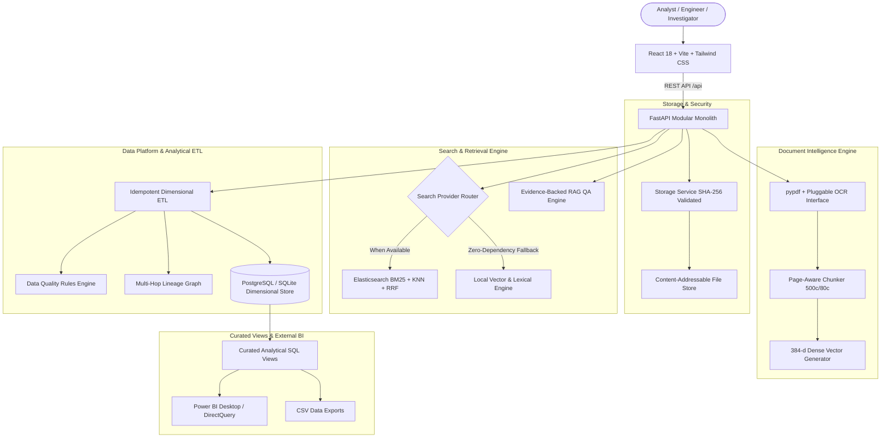
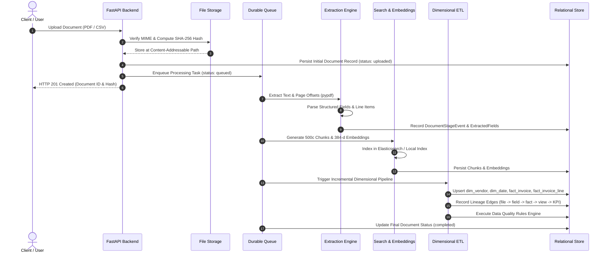

# DataNexus

> **Document Intelligence, Semantic Retrieval, and Analytical Lineage Platform**  
> *"From unstructured documents to trusted, traceable intelligence."*

[](https://www.python.org/)
[](https://fastapi.tiangolo.com/)
[](https://react.dev/)
[](https://www.typescriptlang.org/)
[](https://tailwindcss.com/)
[](LICENSE)
[](backend/tests/)

---

## 1. Product Overview & Motivation

Modern enterprises ingest thousands of invoices, receipts, contracts, and financial PDFs every month. Organizations typically rely on disconnected tools: an OCR utility to extract text, a generic vector database for search, a custom script to populate data warehouses, and separate BI dashboards for reporting. 

When a discrepancy occurs—such as an unexpected $50,000 variance on a quarterly vendor spend KPI—analysts are forced to manually track down the source PDF, search for the page, and guess which transformation produced the metric.

**DataNexus** solves this by unifying document ingestion, native extraction, semantic retrieval, dimensional data engineering, and business intelligence into one cohesive application. 

Its signature capability is **Traceable Intelligence**: the ability to click any analytical KPI or fact table row and inspect its complete lineage DAG all the way back through the ETL transformation to the extracted field, its character offsets, the source page, and the original SHA-256 hashed document.

---

## 2. Target Users

1. **Data Engineers**: Require resilient ingestion pipelines, idempotent batch loading, deterministic data quality auditing, schema drift detection, and full-graph lineage.
2. **Financial & Business Analysts**: Need reliable invoice analytics, multi-currency reporting, supplier spend concentrations, overdue liability tracking, and curated SQL views for Power BI.
3. **Document Investigators & Knowledge Workers**: Need sub-second full-text lexical search, dense semantic vector retrieval, hybrid Reciprocal Rank Fusion (RRF), and evidence-backed question answering with traceable citations.

---

## 3. Core Implemented Capabilities

- **Content-Addressable File Storage**: Deterministic SHA-256 hashing, duplicate detection, MIME type validation, and path traversal protection.
- **Native Document Intelligence**: Multi-page PDF text extraction (`pypdf`) with character-level offsets, confidence metrics, and structured field parsing (invoice number, vendor, date, currency, amounts).
- **Hybrid Retrieval Engine**:
  - BM25 lexical term matching.
  - Dense 384-dimensional $L_2$-normalized vector search.
  - Reciprocal Rank Fusion (RRF) rank aggregation ($k=60$) eliminating score calibration mismatches.
  - Transparent dual-provider architecture: connects to Elasticsearch on port 9200 when available, with automatic graceful fallback to an embedded local vector/lexical provider when offline.
- **Evidence-Backed RAG Question Answering**: Questions are answered strictly using retrieved document evidence. Material claims cite document IDs and page numbers; if evidence is insufficient, the system transparently reports insufficiency rather than hallucinating.
- **Idempotent Star-Schema ETL**: Automated dimensional loading into `dim_vendor`, `dim_date`, `fact_invoice`, `fact_invoice_line`, and `fact_document_processing`.
- **Deterministic Data Quality Engine**: Automated audit across 8 financial and structural rules (completeness, non-negativity, date validity, ISO currency codes, subtotal/tax consistency).
- **Full Lineage Graph (DAG)**: End-to-end directed lineage recording:
  `Raw File -> Document Version -> Extracted Field -> Dimensional Fact -> Curated SQL View -> BI Metric`.
- **Curated SQL Views & Power BI**: 7 pre-aggregated reporting views with explicit foreign key grain and DAX measure specifications.
- **Distinctive Analytical UI**: High-density dark-slate aesthetic inspired by Linear, Stripe, and Metabase across 5 dedicated workspaces.

---

## 4. System Architecture



---

## 5. End-to-End Processing Workflow



---

## 6. Technology Stack & Current Status

| Layer | Implemented Baseline | Planned Next Iteration |
|---|---|---|
| **Frontend** | React 18, TypeScript, Vite, Tailwind CSS, Recharts, Lucide Icons | Virtualized PDF Canvas with visual bounding boxes (`pdfjs-dist`) |
| **Backend API** | Python 3.13, FastAPI, Pydantic v2, Uvicorn | Server-Sent Events (SSE) streaming updates |
| **Relational Store** | SQLite 3 (zero-dependency local development mode) | Managed PostgreSQL 16 container deployment |
| **Search Engine** | Embedded Local RRF Provider (384-d Cosine Similarity + BM25) | Distributed Elasticsearch cluster on port 9200 |
| **Embeddings** | Deterministic 384-d $L_2$-normalized dense embeddings | Transformer embeddings via Sentence-Transformers / HuggingFace |
| **RAG / AI** | Evidence-gated RAG with citation validation | GroqCloud API / Gemini 1.5 Flash live inference |
| **Queue** | Durable database-backed queue (`queue_jobs`) | Distributed Redis + Celery worker pool |
| **BI Integration** | 7 Curated SQL views + Power BI connection specification | Automated `.pbix` template generator |

---

## 7. Repository Layout

```
DataNexus/
├── .env.example                     # Environment configuration template
├── .gitignore                       # Git ignore specification
├── CONTRIBUTING.md                  # Development & contribution guidelines
├── LICENSE                          # MIT License
├── README.md                        # Master project documentation
├── SECURITY.md                      # Vulnerability reporting & security policy
│
├── backend/                         # FastAPI Application
│   ├── requirements.txt             # Python backend dependencies
│   ├── app/
│   │   ├── config.py                # Pydantic environment settings
│   │   ├── database.py              # SQLAlchemy engine & session factory
│   │   ├── main.py                  # FastAPI application entrypoint & middleware
│   │   ├── seed.py                  # Realistic invoice PDF generator & database seeder
│   │   ├── api/                     # REST API route handlers
│   │   │   ├── analytics.py         # KPIs, vendor spend, overdue invoices, performance
│   │   │   ├── data_platform.py     # Pipeline runs, quality scorecard, CSV staging
│   │   │   ├── documents.py         # Upload, inspect, download, reprocess, delete
│   │   │   ├── health.py            # Liveness and deep readiness telemetry probes
│   │   │   ├── lineage.py           # Multi-hop lineage DAG traversal
│   │   │   └── search.py            # Lexical, vector, hybrid search & RAG QA
│   │   ├── models/                  # SQLAlchemy ORM entity models
│   │   │   ├── analytics.py         # Star schema: dim_vendor, dim_date, fact_invoice...
│   │   │   ├── data_platform.py     # PipelineRun, DataQualityResult, LineageEdge...
│   │   │   ├── document.py          # Document, DocumentStageEvent, DocumentChunk...
│   │   │   └── views.py             # DDL for 7 curated analytical SQL views
│   │   ├── schemas/                 # Pydantic request & response validation schemas
│   │   └── services/                # Core platform business logic
│   │       ├── embeddings.py        # 384-d dense vector generator
│   │       ├── extraction.py        # Native PDF parser, regex extraction, chunker
│   │       ├── lineage.py           # Multi-hop lineage graph traverser
│   │       ├── pipeline.py          # Idempotent dimensional ETL pipeline
│   │       ├── qa.py                # Traceable RAG question answering engine
│   │       ├── quality.py           # Deterministic data quality rules engine
│   │       ├── queue.py             # Durable background processing lifecycle manager
│   │       ├── search.py            # Elasticsearch & LocalSearch hybrid providers
│   │       └── storage.py           # SHA-256 content-addressable storage service
│   └── tests/                       # Automated pytest suite (14 passing tests)
│
├── docs/                            # In-Depth Technical Documentation
│   ├── ARCHITECTURE.md              # System architecture, boundaries & state machine
│   ├── DATA_MODEL.md                # Detailed schemas, star schema, facts & views
│   ├── FRONTEND_ARCHITECTURE.md     # Component hierarchy, workspaces & design tokens
│   ├── LOCAL_DEVELOPMENT.md         # Comprehensive setup & troubleshooting guide
│   └── POWER_BI_GUIDE.md            # Power BI connection & DAX measure specifications
│
├── frontend/                        # React 18 + TypeScript + Vite Application
│   ├── package.json                 # Node dependencies & build scripts
│   ├── vite.config.ts               # Vite bundler & API reverse proxy configuration
│   ├── tailwind.config.js           # Design tokens & color system
│   └── src/
│       ├── App.tsx                  # Root application layout
│       ├── components/              # Reusable UI components (Navbar, Sidebar...)
│       ├── pages/                   # 5 Platform Workspaces:
│       │   ├── OverviewPage.tsx     # Operational KPIs & engine latency breakdown
│       │   ├── DocumentsPage.tsx    # Document library, upload modal, confidence badges
│       │   ├── DocumentDetailPage.tsx # Multi-pane investigation workspace & offsets
│       │   ├── SearchPage.tsx       # Lexical, semantic, hybrid search & RAG Q&A
│       │   ├── DataPlatformPage.tsx # ETL runs, lineage DAG & quality scorecard
│       │   └── AnalyticsPage.tsx    # Spend trends, overdue liabilities, Power BI guide
│       ├── services/api.ts          # Strongly-typed API client
│       └── types/index.ts           # Frontend TypeScript domain interfaces
│
├── sample_data/                     # Sample Demonstration Fixtures
│   ├── sample_csv/                  # Master vendor contracts CSV dataset
│   └── sample_invoices/             # Realistic vector PDF invoices
│
└── scripts/                         # Operational & Verification Scripts
    ├── seed_database.py             # Database seeder execution script
    └── smoke_test.py                # Automated end-to-end endpoint verification
```

---

## 8. Local Setup in 3 Minutes

### Prerequisites
- Python 3.11+
- Node.js 18+ and npm
- Git

### Quickstart Commands
```bash
# 1. Clone repository
git clone https://github.com/harshitxmishra/DataNexus.git
cd DataNexus

# 2. Configure environment
cp .env.example .env

# 3. Set up Python virtual environment & install dependencies
python -m venv .venv
# On Windows PowerShell:
.venv\Scripts\Activate.ps1
# On Linux / macOS:
# source .venv/bin/activate
pip install -r backend/requirements.txt

# 4. Install frontend dependencies
cd frontend && npm install && cd ..

# 5. Seed demonstration invoices & dimensional star schema
python scripts/seed_database.py

# 6. Start backend server (Terminal 1)
.venv\Scripts\uvicorn backend.app.main:app --host 127.0.0.1 --port 8008 --reload

# 7. Start frontend application (Terminal 2)
cd frontend && npm run dev
```

- **Frontend Application**: `http://localhost:5173` (or `http://localhost:5174`)
- **Backend API & Swagger Documentation**: `http://127.0.0.1:8008/docs`

---

## 9. Verification & Test Suite

The platform includes a test suite covering document storage, extraction, chunking, embeddings, hybrid retrieval, dimensional ETL, data quality, and API endpoints:

```bash
# Run backend pytest suite:
python -m pytest backend/tests -v
```
```
====================== 14 passed in 36.82s =======================
```

To run the frontend production build:
```bash
cd frontend && npm run build
```
```
✓ 2383 modules transformed.
✓ built in 4.19s (0 errors)
```

To run the live smoke test against running services:
```bash
python scripts/smoke_test.py
```
```
[PASS] All critical smoke tests verified successfully.
```

---

## 10. Roadmap & Planned Enhancements

1. **Managed PostgreSQL Deployment**: Containerize backend services with Docker Compose deploying PostgreSQL 16 as the persistent primary store.
2. **Distributed Elasticsearch Cluster**: Production Helm chart and multi-node Elasticsearch mapping templates for large-scale enterprise deployments.
3. **GroqCloud Inference Integration**: Integrate GroqCloud ultra-fast Llama-3 inference into the pluggable LLM provider for sub-100ms retrieval-augmented question answering.
4. **Power BI DirectQuery Connector**: Provide a pre-built Power BI template (`.pbit`) wired to DataNexus curated PostgreSQL views with dynamic drill-through.
5. **Real-Time Pipeline Streaming**: Implement Server-Sent Events (SSE) in `GET /api/documents/{id}/events` to stream sub-second stage progression to the UI during batch uploads.

---

## 11. Security & Responsible Disclosure

DataNexus enforces safe file handling, directory traversal prevention, parameterized queries, and environment-isolated secret management. For instructions on reporting vulnerabilities, refer to [SECURITY.md](SECURITY.md).

---

## 12. License

This project is licensed under the terms of the [MIT License](LICENSE).
