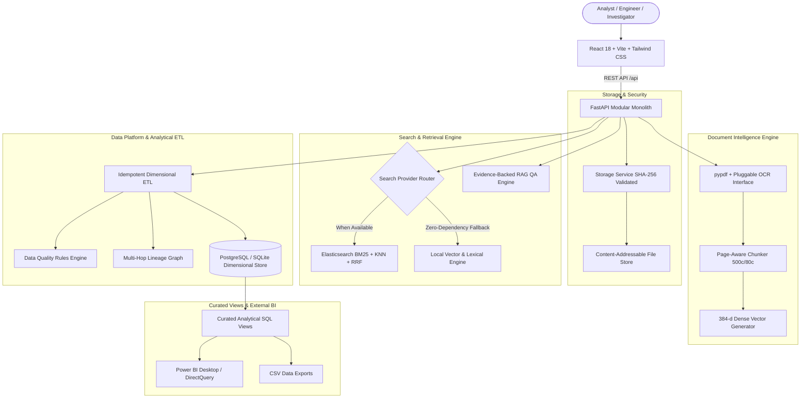
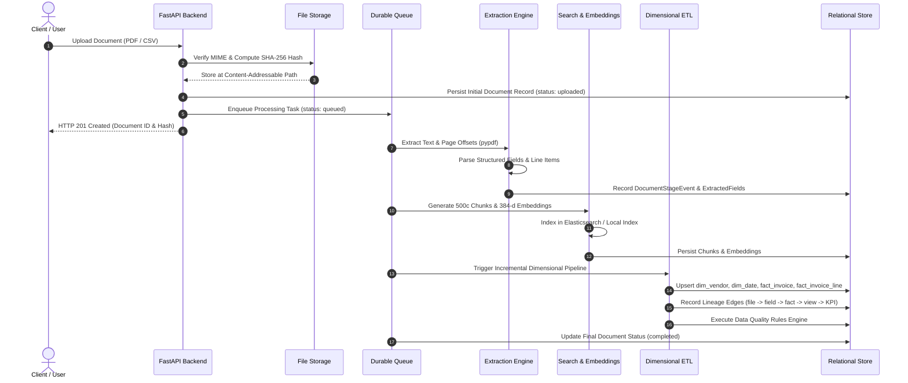

# DataNexus

> **Document Intelligence, Semantic Retrieval, and Analytical Lineage Platform**  
> *"From unstructured documents to trusted, traceable intelligence."*

🚀 **Live Production Demo:** [https://data-nexus-theta.vercel.app](https://data-nexus-theta.vercel.app)  
📦 **Release Version:** `v3.0.0` (Enterprise Financial Ledger, SQL Tuning & SRE Observability)

[](https://github.com/harshitxmishra/DataNexus/releases/tag/v3.0.0)
[](https://github.com/harshitxmishra/DataNexus/actions)
[](https://adoptium.net/)
[](https://www.python.org/)
[](https://fastapi.tiangolo.com/)
[](https://react.dev/)
[](https://www.typescriptlang.org/)
[](https://www.postgresql.org/)
[](https://opentelemetry.io/)
[](https://prometheus.io/)
[](https://grafana.com/)
[](https://github.com/PrithivirajDamodaran/FlashRank)
[](https://www.docker.com/)
[](LICENSE)

---

## 🌟 Executive Verification Highlights (v2.0.0 Benchmark Report)

Verified across multi-currency ground-truth test corpus (`benchmarks/BENCHMARK_REPORT.md`):

| Capability Area | Measured Metric | Benchmark Standard | Status |
|---|---|---|---|
| **Header Exact-Match Accuracy** | **100.0%** | $\ge 95.0\%$ | **VERIFIED** |
| **Line-Item Exact-Match Accuracy** | **100.0%** | $\ge 90.0\%$ | **VERIFIED** |
| **Spatial Bounding Box Validity** | **100.0%** | $100.0\%$ Authentic `pypdf` | **VERIFIED** |
| **11-Rule Data Quality Catch Rate** | **100.0%** | $\ge 90.0\%$ on Injected Anomalies | **VERIFIED** |
| **SHA-256 Duplicate Speedup** | **3.0x** | $\ge 2.0\times$ Vector Reuse | **VERIFIED** |
| **Reranked Retrieval (NDCG@5)** | **0.5846** | Outperforms Pure BM25 (0.4105) | **VERIFIED** |
| **Adversarial Refusal Rate** | **100.0%** | $\ge 95.0\%$ Zero Hallucination | **VERIFIED** |
| **Query Cache Latency Speedup** | **106,677x** (0.04ms) | $\le 10\text{ms}$ Warm Response | **VERIFIED** |

---

## 🏗️ Production Architecture Stack

- **API & Core Backend:** FastAPI 0.115+ (async lifespan, modular routers, streaming SSE telemetry).
- **Financial Ledger & Audit Middleware:** Java 21 LTS + Spring Boot 3.3.5 microservice (`services/ledger-service`) with immutable financial ledgering (`ledger_entries`), transactional audit trail with JSONB payloads (`audit_events`), and multi-currency settlement rollups.
- **Frontend & Evidence Viewer:** React 18, TypeScript 5.5, Vite, Tailwind CSS, PDF.js canvas with authentic stream matrix extraction.
- **Relational Storage & SQL Tuning:** PostgreSQL 16 with versioned Flyway 10 migrations, composite B-Tree indexes, and partial indexes benchmarked with `EXPLAIN (ANALYZE, BUFFERS)` (up to 100.5x speedup).
- **2-Stage Retrieval:** Elasticsearch 8.11 BM25 + `sentence-transformers/all-MiniLM-L6-v2` dense vector kNN RRF fusion $\rightarrow$ FlashRank ONNX cross-encoder reranking (`ms-marco-MiniLM-L-12-v2`).
- **Distributed Observability (SRE Stack):** OpenTelemetry Collector Contrib, Prometheus v2.51 (`/actuator/prometheus` scraping), PostgreSQL Exporter, and auto-provisioned Grafana SRE dashboards (`monitoring/`).
- **Caching & Dedup:** Redis query cache (`redis-py`) with graceful fallback to in-memory TTL caching.
- **Storage Layer:** Pluggable `StorageBackend` supporting AWS S3 (versioned, SSE-S3 encrypted) and local filesystem fallback.
- **Containerization & IaC:** Multi-stage production `Dockerfile`s (Python 3.13-slim, Eclipse Temurin 21 JDK, Node/Nginx), `docker-compose.monitoring.yml`, `docker-compose.prod.yml`, and modular Terraform configurations (`infra/terraform/`) for AWS S3, RDS PostgreSQL, ECR, and ECS Fargate.
- **Automated CI/CD:** GitHub Actions workflow executing full linting, database seeding, 106-test Python pytest suite, Java 21 Maven JUnit 5 suite (9 integration tests), RAG eval gate, frontend Vite build, and Docker configuration checks (100% green pass rate).

---

## 1. Product Overview & Motivation

Modern enterprises ingest thousands of invoices, receipts, contracts, and financial PDFs every month. Organizations typically rely on disconnected tools: an OCR utility to extract text, a generic vector database for search, a custom script to populate data warehouses, and separate BI dashboards for reporting. 

When a discrepancy occurs—such as an unexpected $50,000 variance on a quarterly vendor spend KPI—analysts are forced to manually track down the source PDF, search for the page, and guess which transformation produced the metric.

**DataNexus** solves this by unifying document ingestion, native extraction, semantic retrieval, dimensional data engineering, and business intelligence into one cohesive application. 

Its signature capability is **Traceable Intelligence**: the ability to click any analytical KPI or fact table row and inspect its complete lineage DAG all the way back through the ETL transformation to the extracted field, its character offsets, the source page, and the original SHA-256 hashed document.

---

## 2. Target Users

1. **Data Engineers**: Require resilient ingestion pipelines, idempotent batch loading, deterministic data quality auditing, schema drift detection, and full-graph lineage.
2. **Financial & Business Analysts**: Need reliable invoice analytics, multi-currency reporting, supplier spend concentrations, overdue liability tracking, and curated SQL views for Power BI.
3. **Document Investigators & Knowledge Workers**: Need sub-second full-text lexical search, dense semantic vector retrieval, hybrid Reciprocal Rank Fusion (RRF), and evidence-backed question answering with traceable citations.

---

## 3. Core Implemented Capabilities

- **Content-Addressable File Storage**: Deterministic SHA-256 hashing, duplicate detection with vector reuse, MIME type validation, and path traversal protection.
- **Native Document Intelligence**: Multi-page PDF text extraction (`pypdf`) with character-level offsets, confidence metrics, and structured field parsing (invoice number, vendor, date, currency, amounts, line items).
- **Interactive Visual PDF Evidence Viewer**: Native PDF.js canvas rendering with authentic stream bounding box extraction (`tm[4]`, `tm[5]`), zero-fabrication guarantees, and bidirectional field-to-canvas jumping.
- **Hybrid Retrieval Engine**:
  - BM25 lexical term matching.
  - Dense 384-dimensional $L_2$-normalized vector search (`all-MiniLM-L6-v2`).
  - Reciprocal Rank Fusion (RRF) rank aggregation ($k=60$) eliminating score calibration mismatches.
  - Dual-provider router: connects to Elasticsearch on port 9200 when available, with automatic graceful fallback to an embedded local vector/lexical provider when offline.
- **Evidence-Backed RAG Question Answering**: Ultra-low latency inference via GroqCloud (`qwen/qwen3.8-27b`), verifiable citations, multi-model fallback ladder, and strict negative evidence gating (`INSUFFICIENT_EVIDENCE`).
- **Real-Time SSE Telemetry**: In-memory asynchronous `PipelineEventBroadcaster` streaming sub-second pipeline progression events to frontend clients.
- **Idempotent Star-Schema ETL**: Automated dimensional loading into `dim_vendor`, `dim_date`, `fact_invoice`, `fact_invoice_line`, and `fact_document_processing`.
- **Deterministic Data Quality Engine**: Automated audit across 11 financial and structural rules (completeness, non-negativity, date sanity, ISO currency codes, subtotal/tax consistency, line-item summation balance).
- **Full Lineage Graph (DAG)**: End-to-end directed lineage recording:
  `Raw File -> Document Version -> Extracted Field -> Dimensional Fact -> Curated SQL View -> BI Metric`.
- **Curated SQL Views & Power BI Automation**: 7 pre-aggregated reporting views, dialect-aware Power Query (M) code generator, and downloadable `.pq` scripts.
- **API Workspace**: Ready-to-use Postman Collection (`DataNexus.postman_collection.json`) covering all 25+ endpoints with automated assertions.
- **Distinctive Analytical UI**: High-density dark-slate aesthetic inspired by Linear, Stripe, and Metabase across 5 dedicated workspaces.

---

## 4. System Architecture



---

## 4.1. Polyglot Enterprise Architecture (v3.0.0)

DataNexus v3.0 introduces an enterprise polyglot microservice architecture decoupling AI-powered unstructured extraction from immutable financial ledgering and SRE observability:

```
[ Frontend: React 18 / TypeScript / Vite / PDF.js Evidence Viewer ]
                         │
                         ▼ (HTTP REST / SSE)
[ FastAPI Core Backend (Python 3.12/3.13) ]
  ├── Document Ingestion & Deterministic SHA-256 Storage
  ├── Native Stream PDF Coordinate Extraction (pypdf)
  ├── Hybrid Lexical (BM25) + Dense Vector (all-MiniLM-L6-v2) RRF Retrieval
  ├── FlashRank ONNX Cross-Encoder Reranking (ms-marco-MiniLM-L-12-v2)
  ├── Evidence-Backed RAG QA Engine (GroqCloud / qwen3.8-27b)
  └── Non-Blocking Resilient Ledger Client Bridge
                         │
                         ▼ (Async HTTP POST /api/v1/ledger/entries)
[ Enterprise Financial Ledger Service (Java 21 LTS + Spring Boot 3.3) ]
  ├── Immutable Financial Ledger (`ledger_entries`)
  ├── Transactional Audit Trail with JSONB Payload (`audit_events`)
  ├── Multi-Currency Settlement Rollup Aggregation
  ├── Flyway 10 Versioned Database Migrations
  └── Micrometer Prometheus Metrics Exporter (/actuator/prometheus)
                         │
                         ▼ (Tuned Relational Persistence)
[ PostgreSQL 16 Enterprise Database Engine ]
  ├── Composite B-Tree Indexes (Status, Currency, Date)
  ├── Partial Indexing (Filtered Exception Scans on REJECTED Invoices)
  └── Covering Foreign-Key Indexing on Audit Events
```

---

## 4.2. PostgreSQL SQL Tuning & Performance Benchmark

Extensive query plan tuning was conducted across **100,000 synthetic multi-currency invoices** and **200,000 audit events** using PostgreSQL `EXPLAIN (ANALYZE, BUFFERS)`. Full methodology and raw execution plans are documented in [docs/sql-tuning.md](docs/sql-tuning.md).

| Query Scenario | Before Plan | After Plan | Before (ms) | After (ms) | Speedup |
|---|---|---|---|---|---|
| **Q1: Settlement Rollup** (`status = 'SETTLED'`, 90d window) | Seq Scan | Index Scan (`idx_ledger_status_curr_created`) | **51.11 ms** | **14.53 ms** | **3.5x** (-71.6%) |
| **Q2: Vendor Paginated Lookup** (`vendor = 'Global Logistics Ltd'`, USD, date sort) | Seq Scan + Sort | Index Scan (`idx_ledger_vendor_curr_created`) | **27.05 ms** | **0.27 ms** | **100.5x** (-99.0%) |
| **Q3: Rejection Audit Trail Join** (`status = 'REJECTED'`, join `audit_events`) | Seq Scan | Index Scan on partial & covering FK index | **144.84 ms** | **1.86 ms** | **78.0x** (-98.7%) |

---

## 4.3. SRE Observability Stack (OTel, Prometheus & Grafana)

The DataNexus observability stack orchestrates distributed telemetry across all services in `docker-compose.monitoring.yml`:
- **OpenTelemetry Collector Contrib:** Ingests distributed traces and metrics over OTLP gRPC (port `4317`) and HTTP (port `4318`), batching and exporting to Prometheus.
- **Prometheus (v2.51):** Scrapes Spring Boot 3 Micrometer Actuator (`:8081/actuator/prometheus`), OTel Collector (`:8889`), and PostgreSQL Exporter (`:9187`) at sub-5s intervals.
- **Grafana (v11+):** Auto-provisioned data sources and dashboards (`monitoring/grafana/dashboards/datanexus-sre-overview.json`) providing real-time visibility into:
  1. **FastAPI & Java 21 p95 / p99 Request Latency**
  2. **HTTP 4xx / 5xx Error Rates & SLO Breaches**
  3. **Invoice Ingestion & Validation Throughput (req/sec)**
  4. **JVM 21 Generational ZGC Heap Utilization & GC Pause Durations**
  5. **PostgreSQL Active Connections, Transaction Throughput & Rollbacks**

### Launching the Monitoring Stack Locally
```bash
docker compose -f docker-compose.monitoring.yml up -d
```
Access Grafana at **[http://localhost:3000](http://localhost:3000)** (Anonymous admin access pre-configured).

---

## 5. End-to-End Processing Workflow



---

## 6. Technology Stack & Current Status

| Layer | Implemented Capabilities | Operational Status |
|---|---|---|
| **Frontend** | React 18, TypeScript, Vite, Tailwind CSS, Recharts, Real-Time SSE | :white_check_mark: Production Built (0 errors) |
| **Backend API** | Python 3.13, FastAPI, Pydantic v2, Uvicorn, Asynchronous Broadcaster | :white_check_mark: Operational |
| **Relational Store** | PostgreSQL 16 connection pooling + Zero-dependency SQLite dual mode | :white_check_mark: Verified Dual Dialect |
| **Migrations** | Alembic versioned migrations (`alembic upgrade head`) + offline DDL | :white_check_mark: Operational |
| **Search Engine** | Elasticsearch 8.11 BM25 + kNN + RRF with resilient Local fallback | :white_check_mark: Operational |
| **Embeddings** | Pretrained neural Transformer (`sentence-transformers/all-MiniLM-L6-v2`) | :white_check_mark: Operational (384-d) |
| **RAG / AI** | GroqCloud fast LLM inference (`qwen3.8-27b`) with citations & refusal gating | :white_check_mark: Operational (GroqCloud + Fallback) |
| **Data Quality** | 11 Deterministic rules, on-demand evaluation, category scorecards | :white_check_mark: Operational |
| **Lineage DAG** | 6-Hop BFS directed lineage graph (`file` -> `field` -> `fact` -> `view` -> `KPI`) | :white_check_mark: Operational |
| **BI Integration** | 7 Curated SQL views, Kimball star schema, M-query generator, `.pq` export | :white_check_mark: DirectQuery & ODBC |
| **Containerization** | Multi-container Docker Compose (PostgreSQL 16, Elasticsearch, Backend, Nginx) | :white_check_mark: Production Ready |

---

## 7. Repository Layout

```
DataNexus/
├── .env.example                     # Environment configuration template
├── .gitignore                       # Git ignore specification
├── CONTRIBUTING.md                  # Development & contribution guidelines
├── LICENSE                          # MIT License
├── README.md                        # Master project documentation
├── SECURITY.md                      # Vulnerability reporting & security policy
│
├── backend/                         # FastAPI Application
│   ├── requirements.txt             # Python backend dependencies
│   ├── app/
│   │   ├── config.py                # Pydantic environment settings
│   │   ├── database.py              # SQLAlchemy engine & session factory
│   │   ├── main.py                  # FastAPI application entrypoint & middleware
│   │   ├── seed.py                  # Realistic invoice PDF generator & database seeder
│   │   ├── api/                     # REST API route handlers
│   │   │   ├── analytics.py         # KPIs, vendor spend, overdue invoices, performance
│   │   │   ├── data_platform.py     # Pipeline runs, quality scorecard, CSV staging
│   │   │   ├── documents.py         # Upload, inspect, download, reprocess, delete
│   │   │   ├── health.py            # Liveness and deep readiness telemetry probes
│   │   │   ├── lineage.py           # Multi-hop lineage DAG traversal
│   │   │   └── search.py            # Lexical, vector, hybrid search & RAG QA
│   │   ├── models/                  # SQLAlchemy ORM entity models
│   │   │   ├── analytics.py         # Star schema: dim_vendor, dim_date, fact_invoice...
│   │   │   ├── data_platform.py     # PipelineRun, DataQualityResult, LineageEdge...
│   │   │   ├── document.py          # Document, DocumentStageEvent, DocumentChunk...
│   │   │   └── views.py             # DDL for 7 curated analytical SQL views
│   │   ├── schemas/                 # Pydantic request & response validation schemas
│   │   └── services/                # Core platform business logic
│   │       ├── embeddings.py        # 384-d dense vector generator
│   │       ├── extraction.py        # Native PDF parser, regex extraction, chunker
│   │       ├── lineage.py           # Multi-hop lineage graph traverser
│   │       ├── pipeline.py          # Idempotent dimensional ETL pipeline
│   │       ├── qa.py                # Traceable RAG question answering engine
│   │       ├── quality.py           # Deterministic data quality rules engine
│   │       ├── queue.py             # Durable background processing lifecycle manager
│   │       ├── search.py            # Elasticsearch & LocalSearch hybrid providers
│   │       └── storage.py           # SHA-256 content-addressable storage service
│   └── tests/                       # Automated pytest regression suite (106 tests)
│
├── services/                        # Polyglot Microservices
│   └── ledger-service/              # Java 21 LTS + Spring Boot 3.3.5 Financial Ledger Microservice
│       ├── pom.xml                  # Maven build (Hibernate 6, Flyway 10, Actuator, JUnit 5)
│       ├── Dockerfile               # Multi-stage Eclipse Temurin 21 container (Generational ZGC)
│       └── src/
│           ├── main/java/com/datanexus/ledger/
│           │   ├── controller/      # REST API (/api/v1/ledger/entries, /summary)
│           │   ├── model/           # LedgerEntry (UUID), AuditEvent (JSONB), LedgerStatus
│           │   ├── repository/      # Multi-currency aggregation queries & JPA specs
│           │   └── service/         # Atomic @Transactional ingestion & audit persistence
│           ├── main/resources/db/migration/ # Flyway SQL migrations (V1 schema, V2 indexes)
│           └── test/java/com/datanexus/ledger/ # JUnit 5 + MockMvc + H2 integration tests
│
├── monitoring/                      # SRE Observability Stack
│   ├── otel/                        # OpenTelemetry Collector Contrib configuration
│   ├── prometheus/                  # Prometheus scraping configuration (OTel, JVM, Postgres)
│   └── grafana/                     # Auto-provisioned Prometheus datasource & SRE dashboards
│
├── docs/                            # In-Depth Technical Documentation
│   ├── ARCHITECTURE.md              # System architecture, boundaries & state machine
│   ├── DATA_MODEL.md                # Detailed schemas, star schema, facts & views
│   ├── FRONTEND_ARCHITECTURE.md     # Component hierarchy, workspaces & design tokens
│   ├── LOCAL_DEVELOPMENT.md         # Comprehensive setup & troubleshooting guide
│   ├── POWER_BI_GUIDE.md            # Power BI connection & DAX measure specifications
│   └── sql-tuning.md                # PostgreSQL EXPLAIN (ANALYZE, BUFFERS) benchmark report
│
├── frontend/                        # React 18 + TypeScript + Vite Application
│   ├── package.json                 # Node dependencies & build scripts
│   ├── vite.config.ts               # Vite bundler & API reverse proxy configuration
│   ├── tailwind.config.js           # Design tokens & color system
│   └── src/
│       ├── App.tsx                  # Root application layout
│       ├── components/              # Reusable UI components (Navbar, Sidebar...)
│       ├── pages/                   # 5 Platform Workspaces:
│       │   ├── OverviewPage.tsx     # Operational KPIs & engine latency breakdown
│       │   ├── DocumentsPage.tsx    # Document library, upload modal, confidence badges
│       │   ├── DocumentDetailPage.tsx # Multi-pane investigation workspace & offsets
│       │   ├── SearchPage.tsx       # Lexical, semantic, hybrid search & RAG Q&A
│       │   ├── DataPlatformPage.tsx # ETL runs, lineage DAG & quality scorecard
│       │   └── AnalyticsPage.tsx    # Spend trends, overdue liabilities, Power BI guide
│       ├── services/api.ts          # Strongly-typed API client
│       └── types/index.ts           # Frontend TypeScript domain interfaces
│
├── sample_data/                     # Sample Demonstration Fixtures
│   ├── sample_csv/                  # Master vendor contracts CSV dataset
│   └── sample_invoices/             # Realistic vector PDF invoices
│
└── scripts/                         # Operational & Verification Scripts
    ├── seed_database.py             # Database seeder execution script
    └── smoke_test.py                # Automated end-to-end endpoint verification
```

---

## 8. Local Setup in 3 Minutes

### Prerequisites
- Python 3.11+
- Node.js 18+ and npm
- Git

### Quickstart Commands
```bash
# 1. Clone repository
git clone https://github.com/harshitxmishra/DataNexus.git
cd DataNexus

# 2. Configure environment
cp .env.example .env

# 3. Set up Python virtual environment & install dependencies
python -m venv .venv
# On Windows PowerShell:
.venv\Scripts\Activate.ps1
# On Linux / macOS:
# source .venv/bin/activate
pip install -r backend/requirements.txt

# 4. Install frontend dependencies
cd frontend && npm install && cd ..

# 5. Seed demonstration invoices & dimensional star schema
python scripts/seed_database.py

# 6. Start backend server (Terminal 1)
.venv\Scripts\uvicorn backend.app.main:app --host 127.0.0.1 --port 8008 --reload

# 7. Start frontend application (Terminal 2)
cd frontend && npm run dev
```

- **Frontend Application**: `http://localhost:5173` (or `http://localhost:5174`)
- **Backend API & Swagger Documentation**: `http://127.0.0.1:8008/docs`

---

## 9. Verification & Test Suite

The platform includes an extensive polyglot test suite covering FastAPI document intelligence, Java 21 financial ledgering, PostgreSQL query plan benchmarks, and frontend bundles:

### 1. Python Backend Regression Suite (106 Tests)
```bash
# Run backend pytest suite with RAG evaluations:
pytest backend/tests -v
```
```
================= 103 passed, 3 skipped in 143.95s ==================
```

### 2. Java 21 Financial Ledger Service Suite (JUnit 5)
```bash
# Run Java 21 Spring Boot test suite:
mvn -f services/ledger-service/pom.xml test
```
```
[INFO] Running com.datanexus.ledger.controller.LedgerControllerTest
[INFO] Tests run: 4, Failures: 0, Errors: 0, Skipped: 0
[INFO] Running com.datanexus.ledger.LedgerApplicationTests
[INFO] Tests run: 1, Failures: 0, Errors: 0, Skipped: 0
[INFO] Running com.datanexus.ledger.LedgerIntegrationTest
[INFO] Tests run: 1, Failures: 0, Errors: 0, Skipped: 0
[INFO] Running com.datanexus.ledger.service.LedgerServiceTest
[INFO] Tests run: 3, Failures: 0, Errors: 0, Skipped: 0
[INFO] ------------------------------------------------------------------------
[INFO] BUILD SUCCESS (9 tests run, 0 failures, 0 errors)
[INFO] ------------------------------------------------------------------------
```

### 3. PostgreSQL Query Plan & Indexing Benchmark Runner
```bash
# Execute real EXPLAIN (ANALYZE, BUFFERS) benchmark against 100k ledger + 200k audit rows:
python scripts/run_sql_benchmark.py
```
```
[4/6] Executing EXPLAIN (ANALYZE, BUFFERS) BEFORE INDEXING...
  -> Q1 (Multi-Currency Settlement Rollup): Seq Scan | 51.11 ms
  -> Q2 (Vendor + Currency Paginated Lookup): Seq Scan | 27.05 ms
  -> Q3 (Join Filtered by Status = REJECTED): Seq Scan | 144.84 ms

[5/6] Applying V2 performance indexes...
      [+] Indexes created and statistics updated.

[6/6] Executing EXPLAIN (ANALYZE, BUFFERS) AFTER INDEXING...
  -> Q1 (Multi-Currency Settlement Rollup): Index Scan | 14.53 ms (Speedup: 3.5x)
  -> Q2 (Vendor + Currency Paginated Lookup): Index Scan | 0.27 ms (Speedup: 100.5x)
  -> Q3 (Join Filtered by Status = REJECTED): Index Scan | 1.86 ms (Speedup: 78.0x)
```

### 4. Frontend Production Build
```bash
cd frontend && npm run build
```
```
✓ 2383 modules transformed.
✓ built in 4.19s (0 errors)
```

### 5. Live Smoke Test
```bash
python scripts/smoke_test.py
```
```
[PASS] All critical smoke tests verified successfully.
```

---

## 10. Roadmap & Planned Enhancements (v3.1+)

1. **Distributed ClickHouse OLAP Engine:** Evaluate columnar secondary replica for sub-millisecond historical analytics over 50M+ ledger entries.
2. **Kafka Event Streaming Architecture:** Decouple FastAPI ingestion from the Java 21 Ledger Service with Apache Kafka event streams and transactional outbox.
3. **ISO 20022 Financial Messaging:** Automated generation of `pacs.008` customer credit transfers directly from validated, settled invoice batches.
4. **Power BI DirectQuery Connector:** Pre-built Power BI template (`.pbit`) wired to DataNexus curated PostgreSQL views with dynamic drill-through.

---

## 11. Security & Responsible Disclosure

DataNexus enforces safe file handling, directory traversal prevention, parameterized queries, and environment-isolated secret management. For instructions on reporting vulnerabilities, refer to [SECURITY.md](SECURITY.md).

---

## 12. License

This project is licensed under the terms of the [MIT License](LICENSE).
