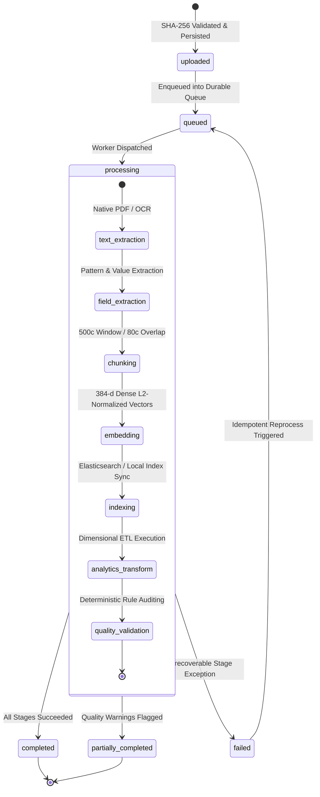
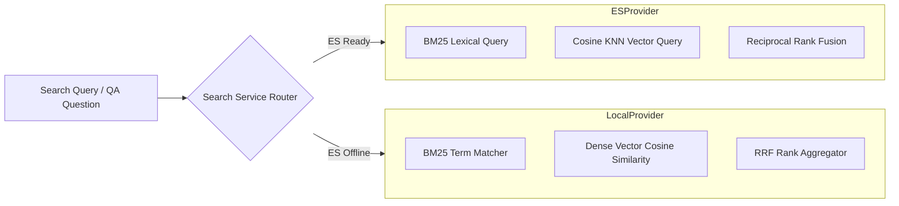
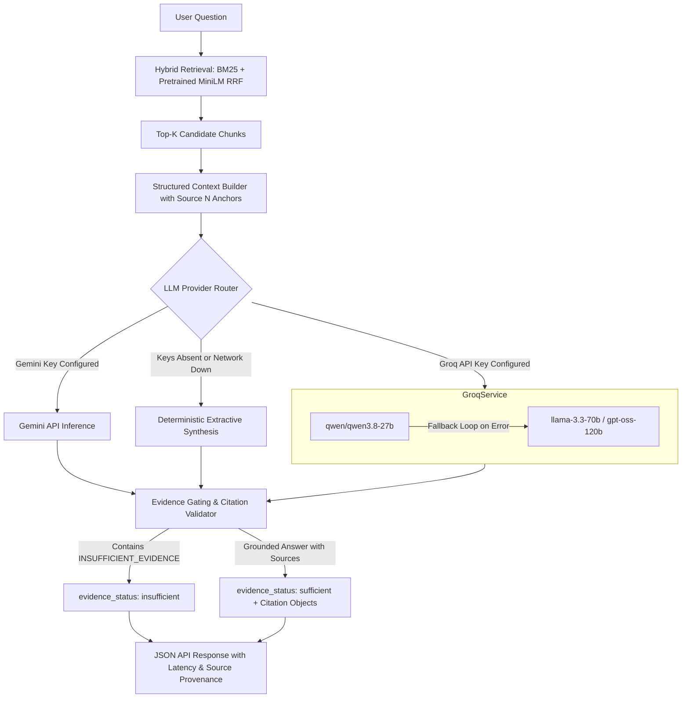
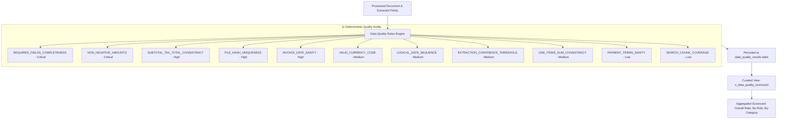

# DataNexus — Architecture & Technical Specifications

## 1. Executive Summary & Vision

**DataNexus** is an enterprise-grade document intelligence, semantic retrieval, data engineering, and business intelligence platform built as a modular monolith.

The defining architectural differentiator of DataNexus is **traceable intelligence**: every aggregated business metric, financial KPI, or analytical record on a dashboard can be traversed backwards through its transformation lineage to the specific extracted field, character offsets, supporting page text, and original binary document.

```
+-------------------+      +---------------------+      +---------------------+      +-------------------+
|  Analytical KPI   | ---> | Staging / Fact Data | ---> |   Extracted Field   | ---> |  Original Source  |
|  (Vendor Spend)   |      |   (fact_invoice)    |      | (char 120-132, p.1) |      | (PDF SHA-256 Hash)|
+-------------------+      +---------------------+      +---------------------+      +-------------------+
```

---

## 2. End-to-End System Architecture


---

## 3. Explicit Architectural Boundaries

| Component | Canonical Responsibility | Hard Architectural Constraint |
|---|---|---|
| **Relational Database** (`PostgreSQL` / `SQLite`) | Canonical source of truth for document metadata, processing states, extracted fields, star-schema analytics, data quality evaluations, and lineage. Managed via Alembic migrations. Uses PostgreSQL connection pooling (`pool_size=10`, `max_overflow=20`) and dialect-aware analytical SQL views. | Never stores raw large binary document streams. Primary PostgreSQL is source of truth; Elasticsearch failures cannot erase canonical records. |
| **Storage Service** | Manages content-addressable storage using SHA-256 hashes with directory traversal sanitization. | Never alters original file bytes; retains immutable raw input. |
| **Elasticsearch** | Fast lexical BM25 indexing, dense vector (384-d) k-nearest neighbor retrieval, and Reciprocal Rank Fusion (RRF). | Never treated as canonical business record authority. |
| **Local Search Engine** | Resilient in-process search provider with cosine similarity over unit-normalized dense vectors and token matching when ES is offline. | Never fabricates artificial similarity scores. |
| **ETL Pipeline** | Idempotent transformation of extracted invoice fields into dimensional star-schema models (`dim_vendor`, `dim_date`, `fact_invoice`, `fact_invoice_line`). | Re-running a batch must never duplicate analytical facts. |
| **Data Quality Engine** | Deterministic rule evaluations (completeness, non-negativity, date validity, currency consistency). | Never automatically alters underlying financial data; flags warnings/failures transparently. |
| **Power BI / BI Consumers** | Read-only access to curated SQL views (`v_invoice_spend_by_vendor`, `v_overdue_invoices`, etc.). | Never queries raw internal staging tables directly. |

---

## 4. Document Processing Lifecycle & State Machine

Every document ingested into DataNexus progresses through an explicit, stage-observable state machine:



### Stage Audit & Failure Semantics
Each processing attempt records:
- **`stage`**: `text_extraction`, `field_extraction`, `chunking`, `embedding`, `indexing`, `analytics_transform`, `quality_validation`.
- **`status`**: `completed`, `failed`, or `skipped`.
- **`duration_ms`**: Stage execution latency measured with high-precision timers.
- **`details`**: Descriptive output (e.g., `"Extracted 1 page(s), 1420 chars. OCR: False"`).

If semantic search indexing fails or is offline, field extraction and analytical transformations are preserved, accurately classifying the document as `partially_completed` rather than blocking the operational pipeline.

---

## 5. Search & Retrieval Architecture

DataNexus implements a dual-provider search architecture via an abstract provider interface:



### Hybrid Retrieval & Reciprocal Rank Fusion (RRF)
To eliminate score calibration discrepancies between lexical BM25 scores (unbounded positive floats) and dense vector cosine similarities (bounded $[-1, 1]$), DataNexus computes RRF scores:

$$RRF(d) = \sum_{m \in \{lexical, semantic\}} \frac{1}{k + \text{rank}_m(d)}$$

### 5.1 Elasticsearch Index Mapping Specification

The Elasticsearch index (default: `datanexus_chunks`) uses deterministic chunk identifiers (`chunk_{chunk_id}`) and a versioned schema:

```json
{
  "mappings": {
    "properties": {
      "chunk_id": { "type": "keyword" },
      "document_id": { "type": "keyword" },
      "filename": {
        "type": "text",
        "fields": { "raw": { "type": "keyword" } }
      },
      "document_type": { "type": "keyword" },
      "page_number": { "type": "integer" },
      "chunk_index": { "type": "integer" },
      "start_char": { "type": "integer" },
      "end_char": { "type": "integer" },
      "content": {
        "type": "text",
        "fields": { "keyword": { "type": "keyword", "ignore_above": 256 } }
      },
      "embedding": {
        "type": "dense_vector",
        "dims": 384,
        "index": true,
        "similarity": "cosine"
      },
      "embedding_model": { "type": "keyword" },
      "embedding_version": { "type": "integer" },
      "created_at": { "type": "date" },
      "version": { "type": "integer" }
    }
  }
}
```

### 5.2 Retrieval Modes & Query DSL

1. **Lexical BM25 Retrieval**:
   Uses multi-match scoring over `content^2.0` and `filename^1.0` with term filtering on `document_type` and highlighted fragments:
   ```json
   {
     "query": {
       "bool": {
         "must": [{
           "multi_match": {
             "query": "invoice payment",
             "fields": ["content^2.0", "filename^1.0"]
           }
         }],
         "filter": [{ "term": { "document_type": "invoice" } }]
       }
     }
   }
   ```

2. **Dense Vector k-NN Retrieval**:
   Executes approximate cosine similarity nearest-neighbor search with 384-dimensional query vectors:
   ```json
   {
     "knn": {
       "field": "embedding",
       "query_vector": [... 384 floats ...],
       "k": 10,
       "num_candidates": 50,
       "filter": [{ "term": { "document_type": "invoice" } }]
     }
   }
   ```

3. **Hybrid Reciprocal Rank Fusion (RRF)**:
   Combines multi-match lexical retrieval and dense vector kNN search in a single pass using Elasticsearch's native `rrf` ranker:
   ```json
   {
     "query": { "bool": { "must": [...] } },
     "knn": { ... },
     "rank": {
       "rrf": {
         "window_size": 50,
         "rank_constant": 60
       }
     }
   }
   ```
   *In local fallback mode, DataNexus executes in-process RRF using the identical smoothing constant $k=60$.*

### 5.3 PostgreSQL-to-Elasticsearch Consistency & Outbox Strategy

PostgreSQL remains the single authoritative source of truth. DataNexus does **not** assume two-phase commits (2PC) or distributed atomic transactions between PostgreSQL and Elasticsearch. Instead, an **outbox state pattern** guarantees eventual consistency and observable failure recovery:

1. **Deterministic Identifiers**: Every document chunk in Elasticsearch is keyed by `chunk_{chunk_id}`, ensuring idempotent upserts via `es.index(index=..., id=f"chunk_{chunk.id}", document=...)`.
2. **Indexing State Flag**: Each `DocumentChunk` row in the database includes an `indexed_in_es` boolean column.
   - When Elasticsearch is reachable and indexing succeeds, `indexed_in_es = True`.
   - If Elasticsearch is offline or times out, `indexed_in_es` remains `False`. Document processing completes with status `partially_completed` (or logged stage completion) without aborting relational ETL or corrupting relational state.
3. **Deletion Propagation**: When a document is deleted via `DELETE /api/documents/{id}`, DataNexus immediately issues a `delete_by_query` request to Elasticsearch:
   ```json
   { "query": { "term": { "document_id": document_id } } }
   ```
4. **Index Reconciliation**: The reconciliation service (`POST /api/search/reconcile`) compares database chunks with Elasticsearch IDs:
   - **Missing Chunks**: Present in PostgreSQL (`indexed_in_es = False`) but absent from Elasticsearch.
   - **Orphaned Chunks**: Present in Elasticsearch but referring to deleted database documents.
   - **Stale Chunks**: Version mismatched or unindexed.
5. **Bulk Reindexing**: `POST /api/search/reindex` utilizes `elasticsearch.helpers.bulk` to stream all eligible chunks from PostgreSQL into Elasticsearch in batches and updates `indexed_in_es = True`.

### 5.4 Pretrained Neural Semantic Embeddings & Representation Migration (Phase 3)

DataNexus incorporates genuine pretrained neural Transformer embeddings via the `sentence-transformers` framework:
- **Default Production Model**: `sentence-transformers/all-MiniLM-L6-v2`
- **Model Revision**: `1110a243fdf4706b3f48f1d95db1a4f5529b4d41`
- **Embedding Dimension**: 384 dimensions, verified finite float output with unit $L_2$ normalization ($\|v\|_2 = 1.0$).
- **Inference Device**: CPU by default (`EMBEDDING_DEVICE=cpu`) with configurable batch size (`EMBEDDING_BATCH_SIZE=32`).
- **Thread Safety**: Thread-safe lazy singleton model loading with initialization error capture.

#### Representation Versioning Contract
To eliminate silent vector space contamination when upgrading models, all representations are explicitly versioned:
- **Version 1 (Legacy / Interim)**: `tfidf-l2-384` deterministic hashing and orthonormal projection. Preserved as `InterimHashingEmbeddingService` for comparative evaluation.
- **Version 2 (Current Neural Standard)**: `sentence-transformers/all-MiniLM-L6-v2`.

Both relational chunks (`document_chunks.embedding_version`) and search index mappings (`embedding_version`) track the representation version. Cross-space vector scoring between incompatible representations is explicitly rejected, guaranteeing no distorted cosine similarities.

#### Safe, Resumable Re-embedding Workflow (`POST /api/search/reembed`)
Upgrading existing documents to the current neural representation is handled through an idempotent, batch-oriented re-embedding service:
1. Identifies chunks where `embedding_version != 2` or `embedding IS NULL`.
2. Batch-encodes chunk contents in configurable batches (default: 32).
3. Atomically updates `embedding`, `embedding_model`, `embedding_version`, and resets `indexed_in_es = False`.
4. Synchronizes updated vectors with the search index (if Elasticsearch is active) or makes them immediately accessible in the local search engine.
5. Safe against partial network/server interrupts: resumption skips already-migrated chunks (`status: "up_to_date"`).

---

## 6. Question Answering & Traceable RAG (Phase 4)

The Retrieval-Augmented Generation (RAG) pipeline guarantees verifiable evidence provenance and strict factual grounding:



### 6.1 GroqCloud LLM Integration (`GroqRAGService`)
DataNexus leverages GroqCloud's LPU inference for high-speed, sub-second generative answer synthesis:
- **Primary Model**: `qwen/qwen3.8-27b` (high-accuracy instruction following, deterministic response generation without reasoning token overhead).
- **Multi-Model Fallback Sequence**: `llama-3.3-70b-versatile`, `llama-3.1-8b-instant`, `openai/gpt-oss-120b`, `openai/gpt-oss-20b`. If the primary model encounters a quota limit, deprecation, or tier mismatch, the fallback loop attempts candidate models sequentially.
- **Client Architecture**: Lazy singleton `Groq` client initialized thread-safely on first request, avoiding overhead during startup or test suites.

### 6.2 Strict Factual Grounding & Prompt Directives
The system prompt enforces strict constraints to eliminate generative hallucinations:
1. **Context-Only Answering**: The model may answer strictly based on the numbered context blocks (`--- Document Chunk [Source N] ---`).
2. **Negative Evidence Gating**: If the provided sources do not contain sufficient facts to answer the question completely and accurately, the model is strictly mandated to begin its answer with:
   ```
   INSUFFICIENT_EVIDENCE: <explanation of what information is missing>
   ```
3. **Mandatory Inline Citations**: Every factual assertion must be attributed using `[Source N]` notation matching the retrieved context chunk index.
4. **Low Temperature**: Configured at `temperature=0.1` for maximum factual fidelity and deterministic output.

### 6.3 Verifiable Citation Mapping
Answers returned by the RAG service parse and map `[Source N]` tags into structured `Citation` domain objects:
- `document_id`: Canonical database ID of the referenced document.
- `document_filename`: Original filename of the supporting document.
- `page_number`: Exact page number containing the supporting text.
- `chunk_id`: Database chunk primary key.
- `snippet`: Extracted text snippet showing the exact supporting evidence.

### 6.4 Resilient Extractive Fallback
If external LLM inference is disabled, unconfigured, or unreachable (e.g., air-gapped environments or complete network failure), DataNexus gracefully degrades to `extractive_evidence_synthesis`:
- Extracts top sentence spans matching query terms from retrieved chunks.
- Preserves all citation metadata, filenames, and page numbers.
- Never raises an unhandled HTTP 500 error or returns an empty payload.

---

## 7. Operational Observability

DataNexus separates health telemetry into two standard probes:
- **Liveness Probe** (`/api/health/liveness`): Confirms the web process is running.
- **Readiness Probe** (`/api/health/readiness`): Inspects connectivity across:
  - Database dialect, connectivity status, and query latency (ms).
  - Elasticsearch connection status and fallback indicator.
  - Embedding provider model name and vector dimension (384).
  - Queue broker durability and operational status.
  - LLM provider configuration status (`ready` vs `fallback_extractive`), active model name, and configuration flag.

---

## 8. Data Quality, Multi-Hop Lineage & Power BI Semantic Architecture (Phase 5)

Phase 5 formalizes the data governance, auditability, and business intelligence foundation of DataNexus.

### 8.1 11-Rule Deterministic Data Quality Governance Engine
DataNexus executes an automated 11-rule deterministic quality audit suite upon document processing and on-demand via `POST /api/data-platform/quality/evaluate`:



#### Rule Classification & Severity Matrix:
| Category | Rule Name | Severity | Condition / Threshold | Failure Action |
|---|---|---|---|---|
| **Completeness** | `REQUIRED_FIELDS_COMPLETENESS` | `critical` | Mandatory presence of `invoice_number`, `vendor_name`, `total_amount`, `invoice_date`. | Flags record as incomplete. |
| **Accuracy** | `NON_NEGATIVE_AMOUNTS` | `critical` | Extracted `total_amount >= 0.00`. | Rejects negative financial balances. |
| **Consistency** | `SUBTOTAL_TAX_TOTAL_CONSISTENCY` | `high` | $\lvert (\text{subtotal} + \text{tax}) - \text{total} \rvert \le 0.05$. | Flags arithmetic discrepancies. |
| **Uniqueness** | `FILE_HASH_UNIQUENESS` | `high` | File SHA-256 hash must be unique across repository. | Flags duplicate document collisions. |
| **Validity** | `INVOICE_DATE_SANITY` | `high` | $\text{2000-01-01} \le \text{invoice\_date} \le \text{today} + 1\text{d}$. | Flags future/anomalous dates. |
| **Validity** | `VALID_CURRENCY_CODE` | `medium` | Currency code in standard ISO-4217 list (`USD`, `EUR`, `GBP`...). | Flags non-standard currencies. |
| **Consistency** | `LOGICAL_DATE_SEQUENCE` | `medium` | $\text{due\_date} \ge \text{invoice\_date}$. | Flags due date preceding invoice date. |
| **Accuracy** | `EXTRACTION_CONFIDENCE_THRESHOLD` | `medium` | Overall extraction confidence $\ge 70.0\%$. | Flags low-confidence extractions. |
| **Consistency** | `LINE_ITEMS_SUM_CONSISTENCY` | `medium` | $\lvert \sum(\text{line\_item.amount}) - \text{subtotal} \rvert \le 0.10$. | Flags line item mismatch. |
| **Validity** | `PAYMENT_TERMS_SANITY` | `low` | Payment terms between $0$ and $180$ days. | Flags non-standard credit terms. |
| **Completeness** | `SEARCH_CHUNK_COVERAGE` | `low` | Generated chunks $\ge 1$. | Flags retrieval blind spots. |

---

### 8.2 Interactive Multi-Hop Directed Lineage Graph
DataNexus records and traverses an explicit 6-hop directed acyclic graph (DAG) enabling end-to-end traceability from high-level BI indicators back to binary source files:

```
[Raw File on Disk] 
      │ (storage.save_upload)
      ▼
[Document Entity] 
      │ (extraction.regex / extraction.ocr)
      ▼
[Extracted Fields] 
      │ (pipeline.field_normalization)
      ▼
[Fact Invoice (Star-Schema)] 
      │ (sql.view_aggregation / sql.view_filter)
      ▼
[Curated Analytical SQL View (v_invoice_spend_by_vendor, v_overdue_invoices)] 
      │ (bi.sum_spend, bi.sum_overdue)
      ▼
[BI Metric / KPI (total_spend_kpi, overdue_exposure_kpi)]
```

#### Traversal Mechanics (`LineageService`):
1. **Document Pipeline Isolation** (`direction="document"`): Traverses precisely the upstream raw binary file and the downstream extracted fields, header fact record, curated SQL views, and BI metrics for the target document without traversing through shared views into other documents.
2. **Upstream Provenance Trace** (`direction="upstream"`): Backward BFS discovering all parent entities up to the source PDF.
3. **Downstream Impact Trace** (`direction="downstream"`): Forward BFS identifying all derived analytical tables, views, and metrics influenced by a node.
4. **Rich Metadata Resolution**: Every node carries resolved attributes (file sizes, field confidence scores, invoice amounts, view descriptions, and DAX metric formulas).

---

### 8.3 Kimball Star Schema & Power BI Semantic Model
DataNexus provides a complete dimensional semantic model exposed through curated SQL views, CSV streaming exports, and DirectQuery / Import parameters.

#### Star-Schema Dimensional Relationships:
```
                +-------------------------+
                |       dim_vendor        |
                +-------------------------+
                | PK: vendor_key          |
                +-------------------------+
                             ▲
                             │ (1 : Many)
                             │
+------------------+    +-------------------------+    +-------------------------+
|     dim_date     |    |      fact_invoice       |    |    fact_invoice_line    |
+------------------+    +-------------------------+    +-------------------------+
| PK: date_key     |◄───┤ FK: vendor_key          |◄───┤ FK: invoice_key         |
+------------------+    | FK: invoice_date_key    |    | PK: line_key            |
                        | FK: due_date_key (inact)|    +-------------------------+
                        | PK: invoice_key         |
                        +-------------------------+
```

#### Curated Analytical SQL Views:
1. `v_daily_ingestion`: Ingestion throughput, byte volume, and duplicate rates.
2. `v_processing_performance`: OCR usage, indexing ratios, and latency distributions by file type.
3. `v_invoice_spend_by_vendor`: Invoiced spend, subtotal, and tax grouped by vendor and currency.
4. `v_overdue_invoices`: Real-time list of unpaid overdue invoices with aging days.
5. `v_data_quality_scorecard`: Pass/warn/fail rates by quality rule and category.
6. `v_pipeline_freshness`: Batch execution latency, row counts, and error rates.
7. `v_indexing_coverage`: Percentage of completed documents indexed in the search engine.

---

## 9. Real-Time Streaming, Power BI Automation & Container Deployment (Phase 6)

### 9.1 Server-Sent Events (SSE) Pub/Sub Engine
DataNexus implements an in-memory asynchronous event broadcasting topology (`PipelineEventBroadcaster` in `backend/app/services/streaming.py`) supporting real-time telemetry streaming:

```
[ProcessingQueueService] ──emit_sync()──► [PipelineEventBroadcaster]
                                                │
                 ┌──────────────────────────────┴──────────────────────────────┐
                 ▼                                                             ▼
    [doc:{id} Subscriber Queues]                                   [global Subscriber Queues]
                 │                                                             │
                 ▼                                                             ▼
    GET /api/documents/{id}/events/stream                        GET /api/documents/events/stream
                 │                                                             │
                 ▼                                                             ▼
     DocumentDetailPage.tsx                                         Platform Monitoring
```

- **Snapshots & Live Transitions**: Connecting to a document stream immediately emits historical completed stage events as a `snapshot` event, followed by live `stage_event`, `pipeline_completed`, or `pipeline_failed` events.
- **Connection Health**: Transmits periodic keepalive `: ping\n\n` comments every 15 seconds to prevent intermediate proxy timeouts.

### 9.2 Automated Power BI M-Query Generation
- **Dialect Sensitivity**: Automatically detects whether PostgreSQL (DirectQuery) or SQLite (ODBC Import) is active and renders optimized M code.
- **Export Bundle**: `GET /api/analytics/powerbi/export-script` compiles all Kimball dimension/fact table M queries and 8 production DAX measures into a downloadable `.pq` script.

### 9.3 Production Multi-Container Orchestration (`docker-compose.yml`)
- **PostgreSQL 16**: Containerized primary store with healthcheck verification (`pg_isready`).
- **Elasticsearch 8.11**: Single-node cluster with 512MB RAM heap configuration and cluster health probing.
- **FastAPI Backend**: Automated entrypoint running Alembic migrations, database self-seeding, and Uvicorn workers.
- **Frontend & Nginx**: Multi-stage Vite build served by Nginx with reverse proxy buffering disabled for SSE streams (`proxy_buffering off;`).

---

## 10. Interactive Visual PDF Evidence & Spatial Coordinate Architecture (Phase 7)

### 10.1 Native Canvas Rendering & Client Worker Packaging
The Document Detail workspace incorporates an interactive, in-browser visual PDF evidence viewer (`PDFVisualEvidenceViewer.tsx`) built directly on Mozilla's `pdfjs-dist`:
- **Vite-Optimized Asset Bundling**: PDF.js web workers are packaged locally using `import pdfWorkerUrl from 'pdfjs-dist/build/pdf.worker.min.js?url'`, eliminating external CDN availability hazards.
- **Hardware-Accelerated HTML5 Canvas**: High-DPI canvas viewports render original binary pages with dynamic zoom levels (75% to 200%), custom pan navigation, and reset-to-fit capabilities.
- **Seamless Document Binary Streaming**: The viewer directly streams raw source binaries via authenticated `GET /api/documents/{id}/download` endpoints.

### 10.2 Content-Stream Spatial Coordinate Extraction (`pypdf` Visitor Transform)
Unlike naive OCR tools that guess pixel positions, DataNexus inspects authentic text transformation matrices directly from the PDF content stream via `PDFEvidenceService` (`backend/app/services/pdf_evidence.py`):
- **Transformation Matrix Parsing**: Intercepts `tm` matrices (`tm[4]` = X, `tm[5]` = Y) and character font sizes through `page.extract_text(visitor_text=visitor)`.
- **Cartesian to Web DOM Normalization**:
  Standard PDF coordinates locate the origin $(0, 0)$ at the bottom-left of the page. The service transforms these to responsive top-left percentages:
  $$\text{norm\_top\_pct} = \frac{\text{page\_height} - y - h}{\text{page\_height}} \times 100\%$$
  $$\text{norm\_left\_pct} = \frac{x}{\text{page\_width}} \times 100\%$$
  $$\text{norm\_width\_pct} = \frac{w}{\text{page\_width}} \times 100\%$$
  $$\text{norm\_height\_pct} = \frac{h}{\text{page\_height}} \times 100\%$$

### 10.3 Strict Zero-Fabrication Integrity Policy
- **No Synthetic Boxes**: If an extracted field or line item cannot be matched with certainty to an authentic text token in the PDF content stream, `bounding_box` is explicitly returned as `None` and `has_coordinates` is set to `False`.
- **Honest Graceful Degradation**: The UI clearly denotes unmapped fields with an honest informational badge ("Visual coordinates not detected in stream. Position verified via character offsets [start..end]"), preserving immutable audit transparency.
- **Non-PDF Handling**: For non-PDF documents (CSV, plain text, tabular files), coordinate extraction gracefully yields `is_pdf: False` and empty coordinate maps without throwing errors or breaking the interface.

### 10.4 Bidirectional Inspector-Viewer Synchronization
- **One-Click Page & Bounding Box Jumping**: Selecting any field or line item in the `Field Evidence & Provenance Inspector` immediately turns the viewer to the target page, animates a high-contrast glowing focus box, and positions a mini field tag directly over the stream evidence.
- **Direct Canvas Interaction**: Clicking any colored bounding box on the PDF canvas triggers `onSelectField`, focusing the corresponding field details in the inspector.


