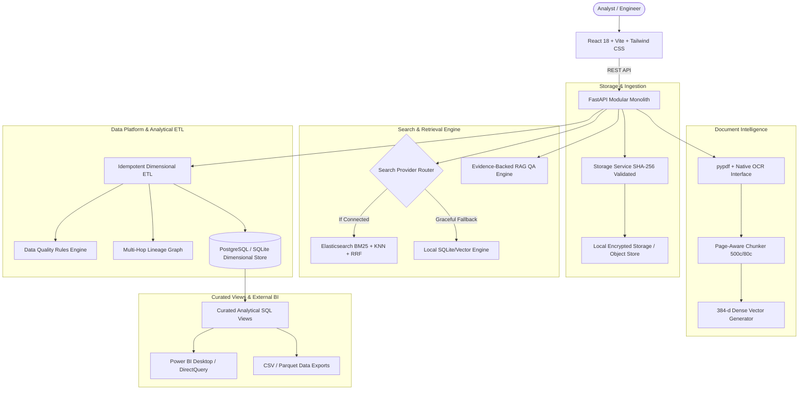

# DataNexus — Architecture & Technical Specifications

## 1. Executive Summary & Vision
**DataNexus** is an end-to-end document intelligence, semantic retrieval, data engineering, and business intelligence platform. Its defining capability is **traceable intelligence**: the ability to inspect an aggregated business KPI or analytical fact on a dashboard and trace it through the ETL transformation pipeline to the extracted field, character offsets, supporting page text, and original binary document.

---

## 2. System Architecture & Component Boundaries



---

## 3. Explicit Responsibility Boundaries

| Component | Canonical Responsibility | Never Allowed |
|---|---|---|
| **PostgreSQL / Relational DB** | Source of truth for document metadata, processing stages, extracted fields, dimensional star schema, data quality results, and lineage. | Storing raw large binaries or unparsed binary streams. |
| **Storage Service** | Content-addressable binary document storage using SHA-256 hashes and directory traversal protection. | Modifying original document bytes. |
| **Elasticsearch** | Lexical BM25 index, dense vector index (384-d), and hybrid Reciprocal Rank Fusion (RRF) retrieval. | Canonical business truth or primary record storage. |
| **Local Search Engine** | Resilient in-process search provider with unit-normalized cosine similarity and BM25 token matching when ES is offline. | Hallucinating relevance scores. |
| **ETL Pipeline** | Idempotent transformation of extracted invoice fields into dimensional star schema (`dim_vendor`, `dim_date`, `fact_invoice`, `fact_invoice_line`). | Duplicating facts on batch re-execution. |
| **Power BI** | Consumption of curated analytical SQL views (`v_invoice_spend_by_vendor`, `v_overdue_invoices`, etc.) for executive reporting. | Directly reading uncurated staging tables. |

---

## 4. Dimensional Data Models & Star Schema

### Dimension Tables
- **`dim_vendor`**
  - **Grain**: One row per unique business vendor.
  - **Key**: `vendor_key` (Integer PK)
  - **Attributes**: `vendor_name`, `normalized_vendor_name`, `category`, `country`, `first_seen_date`.

- **`dim_date`**
  - **Grain**: One row per calendar date.
  - **Key**: `date_key` (Integer YYYYMMDD PK)
  - **Attributes**: `full_date`, `year`, `quarter`, `month`, `month_name`, `week`, `day_of_month`, `day_name`, `is_weekend`.

### Fact Tables
- **`fact_invoice`**
  - **Grain**: One row per verified invoice business record.
  - **Keys**: `invoice_key` (PK), `document_id` (Unique FK), `vendor_key` (FK), `invoice_date_key` (FK), `due_date_key` (FK).
  - **Measures**: `subtotal`, `tax_amount`, `total_amount` (with explicit ISO `currency` code), `days_overdue`, `extraction_confidence`.
  - **Integrity Rule**: Currencies are never aggregated without explicit exchange rates.

- **`fact_invoice_line`**
  - **Grain**: One row per extracted invoice line item.
  - **Keys**: `line_key` (PK), `invoice_key` (FK), `document_id`.
  - **Measures**: `quantity`, `unit_price`, `amount`.

- **`fact_document_processing`**
  - **Grain**: One row per document processing lifecycle attempt.
  - **Measures**: `file_size_bytes`, `page_count`, `processing_time_ms`, `ocr_invoked`, `indexing_succeeded`, `final_status`.

- **`fact_data_quality`**
  - **Grain**: One row per quality rule evaluation.
  - **Attributes**: `rule_name`, `rule_category`, `status`, `severity`, `entity_type`.

- **`fact_pipeline_run`**
  - **Grain**: One row per ETL pipeline execution.
  - **Measures**: `rows_processed`, `rows_rejected`, `duration_ms`.

---

## 5. Curated Analytical SQL Views
1. **`v_daily_ingestion`**: Daily count of ingested documents, total bytes, average pages, and duplicate counts.
2. **`v_processing_performance`**: Average duration ms, success counts, and failure counts by file type.
3. **`v_invoice_spend_by_vendor`**: Aggregate spend, subtotal, tax, and invoice count by vendor and currency.
4. **`v_overdue_invoices`**: Overdue liability amount and days overdue for active cash-flow risk management.
5. **`v_data_quality_scorecard`**: Pass, warning, and failure counts and pass percentages by rule name.
6. **`v_pipeline_freshness`**: Ingestion batch timestamps, rows read/inserted/rejected per pipeline.
7. **`v_indexing_coverage`**: Total documents vs indexed chunks with percentage coverage.

---

## 6. End-to-End Traceability & Lineage
DataNexus persists a directed acyclic graph (DAG) in `lineage_edges` for every document:
```
Raw Binary File (storage_path)
  ↓ [storage.save_upload]
Document (id)
  ↓ [extraction.regex_pattern]
Extracted Field (id)
  ↓ [pipeline.field_normalization]
Fact Invoice (invoice_key)
  ↓ [sql.view_aggregation]
Curated SQL View (v_invoice_spend_by_vendor)
  ↓ [bi.sum_spend]
Analytical Metric (Total Spend KPI)
```
Users can inspect this multi-hop graph visually in the **Data Platform** workspace or jump directly from the **Document Detail** view.
