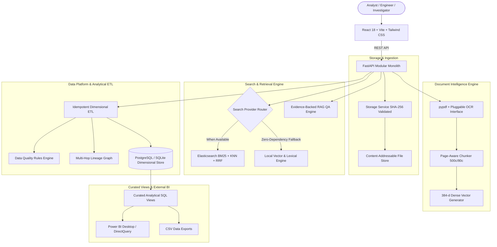
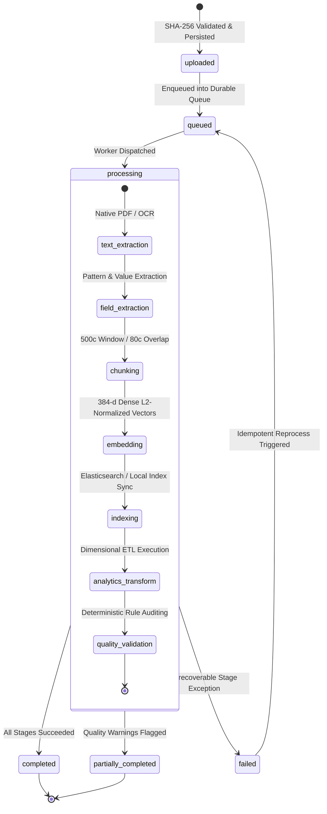
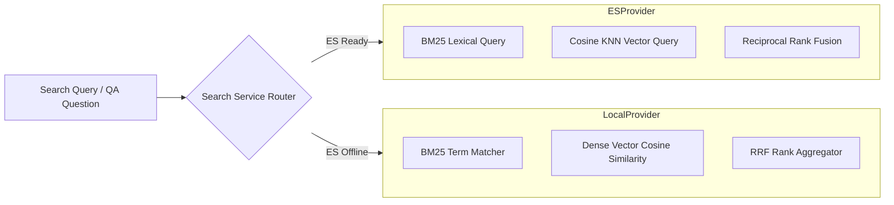

# DataNexus — Architecture & Technical Specifications

## 1. Executive Summary & Vision

**DataNexus** is an enterprise-grade document intelligence, semantic retrieval, data engineering, and business intelligence platform built as a modular monolith.

The defining architectural differentiator of DataNexus is **traceable intelligence**: every aggregated business metric, financial KPI, or analytical record on a dashboard can be traversed backwards through its transformation lineage to the specific extracted field, character offsets, supporting page text, and original binary document.

```
+-------------------+      +---------------------+      +---------------------+      +-------------------+
|  Analytical KPI   | ---> | Staging / Fact Data | ---> |   Extracted Field   | ---> |  Original Source  |
|  (Vendor Spend)   |      |   (fact_invoice)    |      | (char 120-132, p.1) |      | (PDF SHA-256 Hash)|
+-------------------+      +---------------------+      +---------------------+      +-------------------+
```

---

## 2. End-to-End System Architecture



---

## 3. Explicit Architectural Boundaries

| Component | Canonical Responsibility | Hard Architectural Constraint |
|---|---|---|
| **Relational Database** (`PostgreSQL` / `SQLite`) | Canonical source of truth for document metadata, processing states, extracted fields, star-schema analytics, data quality evaluations, and lineage. Managed via Alembic migrations. Uses PostgreSQL connection pooling (`pool_size=10`, `max_overflow=20`) and dialect-aware analytical SQL views. | Never stores raw large binary document streams. Primary PostgreSQL is source of truth; Elasticsearch failures cannot erase canonical records. |
| **Storage Service** | Manages content-addressable storage using SHA-256 hashes with directory traversal sanitization. | Never alters original file bytes; retains immutable raw input. |
| **Elasticsearch** | Fast lexical BM25 indexing, dense vector (384-d) k-nearest neighbor retrieval, and Reciprocal Rank Fusion (RRF). | Never treated as canonical business record authority. |
| **Local Search Engine** | Resilient in-process search provider with cosine similarity over unit-normalized dense vectors and token matching when ES is offline. | Never fabricates artificial similarity scores. |
| **ETL Pipeline** | Idempotent transformation of extracted invoice fields into dimensional star-schema models (`dim_vendor`, `dim_date`, `fact_invoice`, `fact_invoice_line`). | Re-running a batch must never duplicate analytical facts. |
| **Data Quality Engine** | Deterministic rule evaluations (completeness, non-negativity, date validity, currency consistency). | Never automatically alters underlying financial data; flags warnings/failures transparently. |
| **Power BI / BI Consumers** | Read-only access to curated SQL views (`v_invoice_spend_by_vendor`, `v_overdue_invoices`, etc.). | Never queries raw internal staging tables directly. |

---

## 4. Document Processing Lifecycle & State Machine

Every document ingested into DataNexus progresses through an explicit, stage-observable state machine:



### Stage Audit & Failure Semantics
Each processing attempt records:
- **`stage`**: `text_extraction`, `field_extraction`, `chunking`, `embedding`, `indexing`, `analytics_transform`, `quality_validation`.
- **`status`**: `completed`, `failed`, or `skipped`.
- **`duration_ms`**: Stage execution latency measured with high-precision timers.
- **`details`**: Descriptive output (e.g., `"Extracted 1 page(s), 1420 chars. OCR: False"`).

If semantic search indexing fails or is offline, field extraction and analytical transformations are preserved, accurately classifying the document as `partially_completed` rather than blocking the operational pipeline.

---

## 5. Search & Retrieval Architecture

DataNexus implements a dual-provider search architecture via an abstract provider interface:



### Hybrid Retrieval & Reciprocal Rank Fusion (RRF)
To eliminate score calibration discrepancies between lexical BM25 scores (unbounded positive floats) and dense vector cosine similarities (bounded $[-1, 1]$), DataNexus computes RRF scores:

$$RRF(d) = \sum_{m \in \{lexical, semantic\}} \frac{1}{k + \text{rank}_m(d)}$$

Where $k = 60$ is the standard rank smoothing constant.

---

## 6. Question Answering & Traceable RAG

The Retrieval-Augmented Generation (RAG) pipeline guarantees evidence provenance:

1. **Retrieval**: Top-$k$ chunks fetched using hybrid retrieval.
2. **Relevance Gating**: If retrieval scores fall below the minimum relevance threshold, the engine immediately responds with `evidence_status: "insufficient"` rather than hallucinating facts.
3. **Citation Extraction**: When valid evidence exists, answers cite the exact document filename, document ID, and page number.
4. **Transparency**: The response contains the exact chunk excerpts and similarity scores utilized.

---

## 7. Operational Observability

DataNexus separates health telemetry into two standard probes:
- **Liveness Probe** (`/api/health/liveness`): Confirms the web process is running.
- **Readiness Probe** (`/api/health/readiness`): Inspects connectivity across:
  - Database dialect, connectivity status, and query latency (ms).
  - Elasticsearch connection status and fallback indicator.
  - Embedding provider model name and vector dimension (384).
  - Queue broker durability and operational status.
  - LLM provider configuration status.
