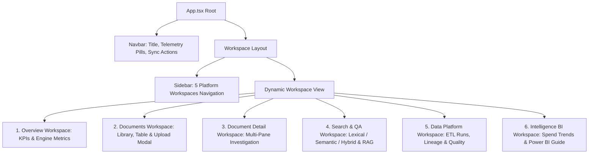

# DataNexus — Frontend Architecture & Design System

## 1. Design Philosophy & Aesthetic Principles

The DataNexus frontend is built as a purpose-built analytical instrument inspired by the engineering rigor of **Linear**, the monetary formatting precision of **Stripe**, the approachable exploration of **Metabase**, and the infrastructure observability of **Vercel**.

### Key Rules Followed
- **No Generic AI SaaS Templates**: No glowing purple gradients, oversaturated borders, decorative AI sparkles, or oversized cards.
- **Editorial Hierarchy**: A restrained dark-slate palette (`#020617`, `#0f172a`, `#1e293b`) with purposeful semantic accents:
  - Cyan (`#0ea5e9` / `#38bdf8`) for primary actions, navigation, and retrieval highlights.
  - Emerald (`#10b981`) for completed statuses, verified evidence, and passing quality rules.
  - Amber (`#f59e0b`) for warnings, partial completions, and review requirements.
  - Rose (`#f43f5e`) for processing errors, rule violations, and overdue statuses.
- **Micro-Typography**: High-density monospace formatting (`font-mono`) for SHA-256 hashes, timestamps, currency amounts, character offsets, and execution durations.

---

## 2. Workspace & Component Hierarchy

The frontend is organized into 5 primary workspaces managed by a persistent high-density shell:

---

## 3. Workspaces Detail

### 3.1 Overview (`OverviewPage.tsx`)
- **Top Metric Cards**: Real-time operational KPIs calculated from database records:
  - Total Documents Ingested & Completed.
  - Total Spend in USD.
  - Data Quality Pass Rate (%) with active rule counts.
  - Search Indexing Coverage (%) and Backlog Queue Count.
- **Engine Performance Table**: Breakdown of processed documents by MIME type, success/failure counts, average processing latency (ms), and indexing status.
- **Workspace Navigation Cards**: Direct shortcuts to common analyst flows.

### 3.2 Documents (`DocumentsPage.tsx` & `DocumentDetailPage.tsx`)
- **Document Library**: High-density table featuring:
  - Ingestion timestamp and document type.
  - SHA-256 hash preview with full-hash hover inspection.
  - Processing status badge with stage tooltips.
  - Extraction confidence score indicator.
  - Modal for drag-and-drop or file-picker upload.
  - Actions for document detail inspection, re-processing, and safe deletion.
- **Document Detail Workspace** (The Signature Investigation Screen):
  - **Left Pane**: Page-by-page extracted raw text with page navigation tabs.
  - **Right Pane**: Tabbed investigation tool:
    - *Extracted Fields*: Tabular view of invoice number, vendor, date, currency, subtotal, tax, and total. Clicking any field highlights its page provenance and character offsets.
    - *Line Items*: Table of extracted line descriptions, quantities, unit prices, and amounts.
    - *Search Chunks*: Inspectable text windows with chunk IDs and character bounds.
    - *Processing Stages*: Timeline of all executed stages with execution duration (ms) and status.

### 3.3 Search & Intelligence (`SearchPage.tsx`)
- **Dual-Mode Search & Q&A Workspace**:
  - Retrieval Mode selector: **Hybrid (RRF)**, **Dense Semantic Vector (384-d)**, or **Lexical (BM25)**.
  - Top-$k$ slider control (1 to 20 results).
  - Search results display with snippet excerpts, document metadata, page citations, and exact score badges.
  - Dedicated **Evidence-Backed Q&A Tab**: Ask questions over indexed documents. The engine generates answers citing supporting documents and pages, or clearly states when evidence is insufficient.

### 3.4 Data Platform (`DataPlatformPage.tsx`)
- **ETL Runs & Batch History**: Table of recent pipeline execution batches, rows read, inserted, updated, and rejected, with duration tracking.
- **Data Quality Scorecard**: Pass/fail/warning rates across 8 deterministic business rules with filterable audit records.
- **Interactive Lineage Graph**: Visual dependency graph tracing:
  `Raw File -> Document Version -> Extracted Field -> Dimensional Fact -> Curated View -> Analytical KPI`.
- **CSV Dataset Staging**: Modal for uploading CSV contracts or operational tables with schema drift detection and batch tracking.

### 3.5 Business Intelligence (`AnalyticsPage.tsx`)
- **Invoice Spend Trends**: Recharts-powered monthly spend line chart by currency.
- **Vendor Concentration**: Bar chart of total spend grouped by supplier.
- **Overdue Invoices Table**: Real-time overdue liabilities with calculated days overdue.
- **Duplicate Invoices Panel**: SHA-256 and business key duplicate detection candidates.
- **Power BI Integration Guide**: Direct instructions, connection strings, and DAX measure patterns.

---

## 4. API Client & Telemetry Architecture

All backend communication is centralized in [`frontend/src/services/api.ts`](file:///c:/Users/SujeetMishra/Desktop/Data_Nexus/DataNexus/frontend/src/services/api.ts):
- Standardized `fetch` calls targeting the relative `/api` base URL.
- In development, Vite proxies `/api` to the active FastAPI backend (`http://localhost:8008`).
- Typed domain models defined in [`frontend/src/types/index.ts`](file:///c:/Users/SujeetMishra/Desktop/Data_Nexus/DataNexus/frontend/src/types/index.ts).
- Error handling with structured error banners and granular retry mechanisms.
- Periodic readiness telemetry polling in the Navbar to display live database latency, embedding model dimension, and search provider status.
