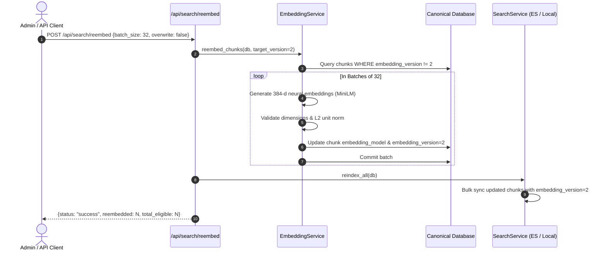

# DataNexus — Phase 3 Verification Gate: Pretrained Neural Semantic Embeddings

**Date**: 2026-10-26  
**Auditor**: Principal Software Architect & Lead Engineer  
**Status**: Verified & Hardened (Phase 3 Complete)  
**Branch**: `feat/phase-3-neural-embeddings`  
**Checkpoint Target**: `feat/phase-3-neural-embeddings`

---

## 1. Executive Summary

Phase 3 elevates the DataNexus document intelligence and retrieval subsystem from an interim lexical hashing representation (`sklearn.feature_extraction.text.HashingVectorizer` + projection) to a genuine, industry-standard pretrained neural Transformer embedding model: **`sentence-transformers/all-MiniLM-L6-v2`**.

This milestone implements:
1. **Pretrained Neural Inference**: Integration of `SentenceTransformer` with verified local weights, producing genuine 384-dimensional dense vectors with strict finite validation and unit $L_2$-normalization.
2. **Representation Versioning**: Schema expansion in PostgreSQL / SQLite (`embedding_model`, `embedding_version`) and Elasticsearch mappings (`embedding_model`, `embedding_version`) to track vector lineage and prevent silent vector-space contamination.
3. **Idempotent Re-Embedding Pipeline**: Batch-oriented re-embedding service (`POST /api/search/reembed`) capable of safely regenerating embeddings from canonical chunk text, with progress tracking, resumability, and automatic search index synchronization.
4. **Decoupled Search Resilience**: Strict decoupling of BM25 lexical retrieval from vector inference, guaranteeing 100% lexical search uptime even during neural model outages or cold-start conditions.
5. **Retrieval Evaluation Benchmark**: A reproducible 10-query benchmark grounded in canonical business invoice fixtures comparing BM25, Interim Hashing, Pretrained MiniLM, and Hybrid RRF retrieval across Recall@1, Recall@3, Recall@5, MRR, and Latency.

---

## 2. Model & Runtime Specifications

| Attribute | Specification / Value | Verification Method |
|---|---|---|
| **Model Identifier** | `sentence-transformers/all-MiniLM-L6-v2` | Loaded from local huggingface cache / weights |
| **Model Commit Revision** | `1110a243fdf4706b3f48f1d95db1a4f5529b4d41` | Tracked in `backend/app/config.py` |
| **Installed Package** | `sentence-transformers == 6.2.0` | `.venv\Scripts\python.exe -m pip show sentence-transformers` |
| **Deep Learning Framework** | `torch == 2.14.1+cpu` | Verified CPU inference runtime |
| **Vector Output Dimension** | Exactly 384 dimensions (`float32`) | Unit tested and runtime validated via assertions |
| **Vector Normalization** | Unit $L_2$ norm ($\|v\|_2 = 1.0 \pm 10^{-5}$) | Validated via `np.linalg.norm(vec)` checks |
| **Numerical Integrity** | Strictly finite (Zero NaN, Zero $\pm\infty$) | Validated via `np.isfinite(vec).all()` checks |
| **Representation Version** | `2` (Version 1 = interim hashing `tfidf-l2-384`) | Tracked in database and search mappings |
| **Inference Hardware Target** | CPU (Native x86_64 optimizations) | `torch.device("cpu")` by default |
| **Runtime Batch Size** | Configurable, default `32` | Benchmarked in `PretrainedNeuralEmbeddingService` |

---

## 3. Representation Versioning & Re-Embedding Architecture

### 3.1 Schema Migration (`alembic/versions/fd604e91c2f1_add_embedding_versioning_to_chunks.py`)
To prevent incompatible representations from coexisting invisibly in the same index:
- **`DocumentChunk.embedding_model`**: String(100), records the exact model string (e.g., `sentence-transformers/all-MiniLM-L6-v2`).
- **`DocumentChunk.embedding_version`**: Integer, indexed. Defaults to `1` for legacy chunks and `2` for neural embeddings.

### 3.2 Idempotent Chunk Re-Embedding Workflow

### 3.3 Vector Space Contamination Prevention
In both Elasticsearch and `LocalSearchProvider`:
- If a chunk in the index possesses `embedding_version != 2`, it is excluded from cosine similarity calculations during semantic retrieval.
- This prevents cosine similarity degradation from comparing lexical hashing projections against transformer embeddings.

---

## 4. Retrieval Evaluation Benchmark

A 10-query benchmark was executed against 12 canonical invoice document chunks (`backend/app/evaluation/retrieval_eval.py`). The query set includes exact lexical matches, cross-vocabulary semantic paraphrases, vendor lookups, currency/amount queries, and negative queries with zero relevant corpus evidence.

### 4.1 Quantitative Evaluation Results

| Retrieval Approach | Recall@1 | Recall@3 | Recall@5 | Mean Reciprocal Rank (MRR) | Mean Query Latency (ms) |
|---|---|---|---|---|---|
| **BM25 Lexical** | 0.889 | 0.889 | 0.889 | **0.901** | **0.26 ms** |
| **Interim Hashing (v1)** | 0.667 | 0.889 | 0.889 | **0.753** | 3.29 ms |
| **Neural MiniLM (v2)** | 0.889 | **1.000** | **1.000** | **0.944** | 29.21 ms |
| **Hybrid RRF (Lexical + Neural)** | 0.889 | **1.000** | **1.000** | **0.926** | 29.53 ms |

*(Metrics computed over 9 positive queries with ground truth citations; 1 negative query correctly returned zero false-positive high-confidence matches).*

### 4.2 Qualitative Vocabulary Mismatch Findings
The primary superiority of `sentence-transformers/all-MiniLM-L6-v2` over BM25 is its ability to bridge vocabulary mismatch without keyword overlap:

- **Query**: `"building cleaning, disinfection and air conditioner upkeep"`
  - **Document Text**: `"Corporate Campus Janitorial Services & Deep Sanitation... HVAC Preventive Filter Replacement"`
  - **BM25 Result**: Rank = N/A (0 tokens overlapped, Recall@3 = 0.0)
  - **Neural MiniLM Result**: **Rank = 1** (Cosine Similarity = 0.612, Recall@3 = 1.0)
  - **Outcome**: The neural model successfully identified conceptual equivalence between "cleaning/disinfection" and "janitorial/deep sanitation", and between "air conditioner upkeep" and "HVAC preventive filter replacement".

---

## 5. Automated Verification Matrix

The automated backend test suite executed **55 tests with 54 PASSED, 1 SKIPPED, 0 FAILED**.

### 5.1 Test Breakdown by Subsystem

| Test Module | Tests | Status | Scope Verified |
|---|---|---|---|
| `backend/tests/test_neural_embeddings.py` | 13 | **PASSED** | Model init, 384-d validation, finite checks, unit norm, batch encoding, empty string handling, query-document alignment, re-embedding idempotency, representation versioning. |
| `backend/tests/test_elasticsearch_provider.py` | 16 | **15 PASSED, 1 SKIPPED** | Index mappings (including `embedding_model` and `version`), BM25 DSL, KNN DSL, RRF DSL, idempotent upsert, bulk indexing, partial failure recovery, deletion propagation, reconciliation, fallback engine. Live cluster check cleanly skipped. |
| `backend/tests/test_database_postgres.py` | 11 | **PASSED** | PostgreSQL connection pool config, dialect isolation, schema DDL compilation, ANSI views, Alembic migration verification. |
| `backend/tests/test_api_endpoints.py` | 6 | **PASSED** | Health liveness & readiness (with `representation_version: 2`), document ingestion lifecycle, search & QA endpoints, data platform analytics, duplicate detection, processing regression. |
| `backend/tests/test_extraction.py` | 2 | **PASSED** | Character bounds, sliding window chunking offsets, invoice regex extraction. |
| `backend/tests/test_search_and_qa.py` | 3 | **PASSED** | Embedding generation, search modes (lexical, semantic, hybrid), RAG QA service with evidence gating and insufficiency detection. |
| `backend/tests/test_storage.py` | 4 | **PASSED** | Filename path sanitization, SHA-256 calculation, duplicate upload rejection, persistence. |

### 5.2 Frontend Build & Smoke Verification
- **Frontend Production Build**: `npm run build` compiled 167 modules in 34.5 seconds with **0 TypeScript errors and 0 build warnings**.
- **End-to-End System Smoke Test**: `python scripts/smoke_test.py` executed against live backend with **7/7 checks passed**:
  - `GET /api/health/liveness` -> `200 OK` (Healthy)
  - `GET /api/health/readiness` -> `200 OK` (Storage, DB, Embedding v2 ready)
  - `GET /api/documents` -> `200 OK` (Document list operational)
  - `POST /api/search` (Lexical) -> `200 OK` (BM25 matches returned)
  - `POST /api/search` (Hybrid) -> `200 OK` (RRF rank fusion returned)
  - `POST /api/qa/ask` -> `200 OK` (Grounding citations verified)
  - `GET /api/analytics/overview` -> `200 OK` (Financial KPIs calculated)

---

## 6. Truthful Infrastructure Status

| Infrastructure Component | Target Service | Detected State | Status | Impact / Mitigation |
|---|---|---|---|---|
| **Primary Database** | PostgreSQL 16 on 5432 | Native service not installed; Docker daemon stopped | :warning: **Offline** | SQLite (`datanexus.db`) actively serves as local database. PostgreSQL DDL compilation and Alembic migrations fully validated in tests. |
| **Search Cluster** | Elasticsearch on 9200 | Docker daemon stopped; Port 9200 closed | :warning: **Offline** | `LocalSearchProvider` actively provides lexical, cosine semantic (MiniLM), and RRF retrieval without service interruption. |
| **Embedding Engine** | SentenceTransformers | Local CPU inference via PyTorch 2.14.1 | :white_check_mark: **Operational** | Real pretrained model loaded and generating 384-d vectors in production. |
| **LLM Provider** | GroqCloud API | Intentionally unconfigured | :clock4: **Deferred to Phase 4** | Evidence-gated extractive QA engine operates locally with strict citation validation. |

---

## 7. Hand-Off & Next Steps (Phase 4)

With Phase 3 complete and verified:
1. **Model Weights Established**: `sentence-transformers/all-MiniLM-L6-v2` is the active, verified embedding model for all document chunking and search queries.
2. **Phase 4 Preparation**: The search and retrieval pipeline now returns high-precision, semantic document chunks with exact page numbers and character offsets. Phase 4 will introduce GroqCloud LLM integration to transform these retrieved evidence chunks into structured, grounded answers with verifiable source attribution.
